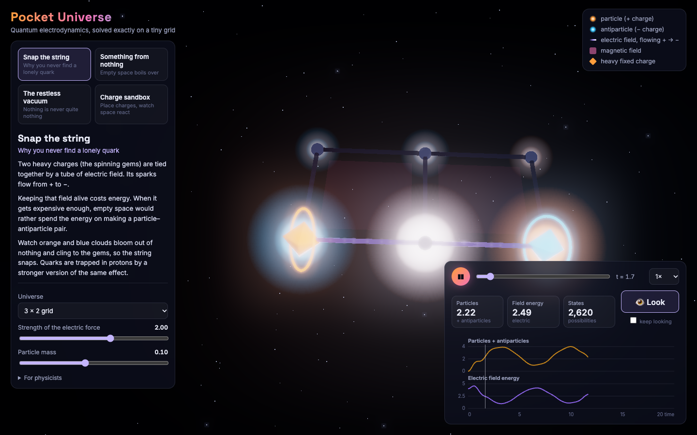

# Lattice gauge theory: 2+1D lattice QED

Master's project on U(1) lattice gauge theory (quantum electrodynamics on a 2D grid in real time),
now rebuilt as **Pocket Universe**, an interactive 3D web app that solves the model exactly in the browser.



## Pocket Universe (`web/`)

```bash
cd web
pnpm install
pnpm dev          # open the printed URL
pnpm test         # physics tests, including the brute-force cross-check
pnpm build        # static site in web/dist
```

Four stories, written for people who are not physicists:

| Story | What happens |
|---|---|
| **Snap the string** | Two static charges joined by a flux tube. Pair creation breaks the string (a toy model of confinement). |
| **Something from nothing** | A quench from the bare vacuum: particle–antiparticle pairs appear out of empty space. |
| **The restless vacuum** | The interacting ground state. “Look” draws random measurement outcomes from \|ψ\|². |
| **Charge sandbox** | Click sites to place static charges and see how the vacuum screens them. |

### Model

Kogut–Susskind Hamiltonian with two-component Wilson fermions, lattice spacing a = 1:

```
H = (m + d·r) Σ ψ̄ψ  +  g²/2 Σ_links E²  −  1/(2g²) Σ_plaquettes (U_□ + h.c.)
    − ½ Σ_{n,k} ψ̄(n) (r − iγ_k) U_k(n) ψ(n+k) + h.c.
```

with γ⁰ = σ_z and α_x, α_y = σ_x, σ_y. Links use the spin-1 truncation (E ∈ {−1, 0, 1}, U raises E by one),
and fermions get Jordan–Wigner signs. Static background charges enter through Gauss’s law
`div E(n) = q(n) + Q(n)`.

### How it is fast

The old Python code built the full tensor-product space (`2^(2N)·3^(2N)` states), filtered it for
Gauss’s law in a Python loop, and filled dense projected operators element by element.
The new engine (`web/src/physics/`):

- **Builds only gauge-invariant states.** A pruned depth-first search runs over link configurations,
  and Gauss’s law then fixes the fermions at each site (a two-fold choice where the charge is zero).
  States are looked up in O(1) with a base-3 link code plus a rank.
- **Builds a sparse Hamiltonian directly** in that basis, split into mass, electric, plaquette and hopping parts,
  so sliders only change weights.
- **Lanczos** for ground states and **Krylov exp(−iHt)** for time evolution, in a Web Worker
  that streams frames to the renderer.

| Lattice | Gauge-invariant states | Build H | Ground state |
|---|---|---|---|
| 2×2 periodic | 6 336 | 26 ms | 50 ms |
| 3×2 open | 3 930 | 24 ms | 19 ms |
| 4×2 open | 103 786 | 0.3 s | 0.7 s |
| 3×2 periodic | 368 784 | 1.2 s | 3.6 s |
| 3×3 open | 806 568 | 3.4 s | 6.6 s |

(Node, single thread, m = 0.3, g = 1.2, r = 1.)

`tools/brute_force_reference.py` is an independent scipy implementation. It uses the full
Kronecker-product space, explicit Jordan–Wigner strings and Gauss-law projection.
`web/src/physics/reference.test.ts` checks the engine against it: dimensions, ground energies, and the complex
Loschmidt amplitude ⟨vac|e^{−iHt}|vac⟩.

## Legacy code

The original thesis code is kept untouched in the other folders (`LGT/`, `Spin_1_fields/`,
`Non_per_1/`, `Only_fields/`). It needs Python 3.7-era `qutip` and has hard-coded data paths.
